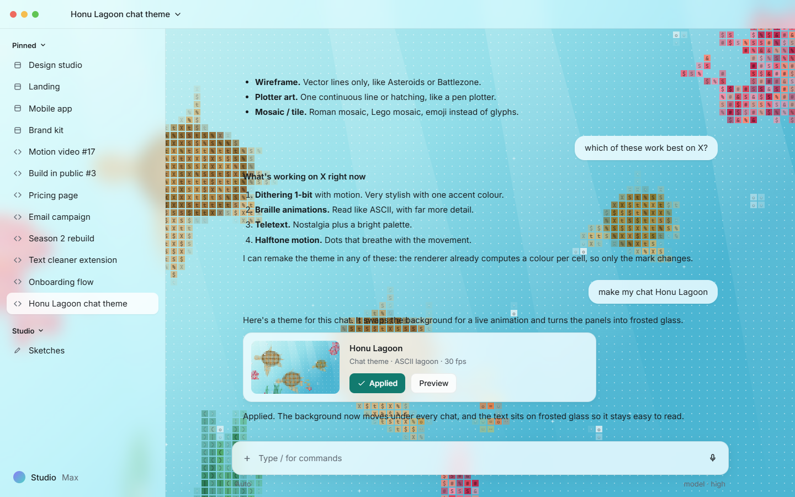
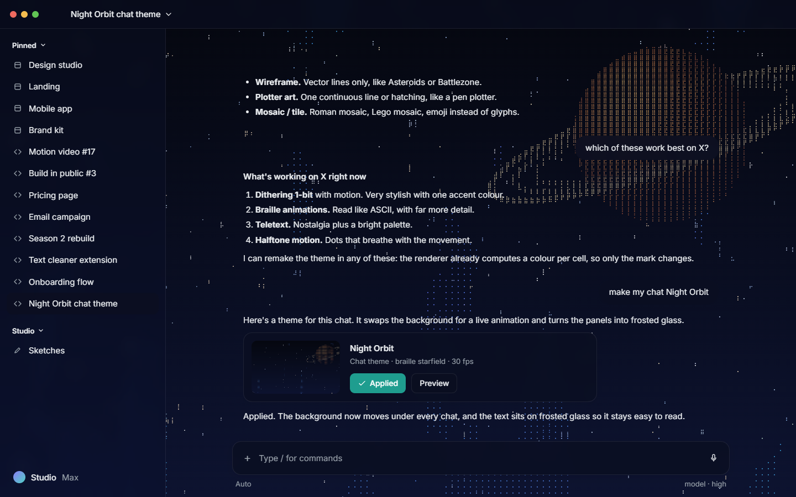
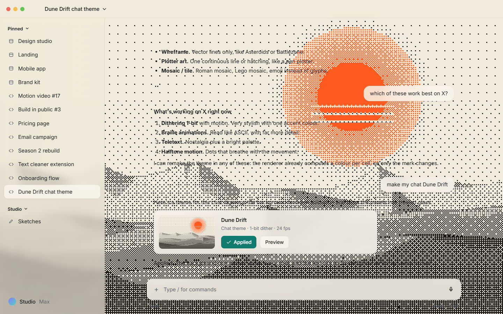
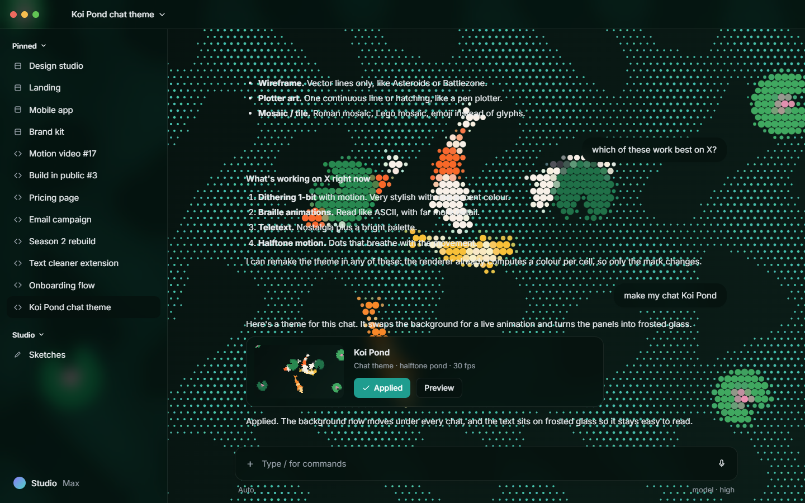
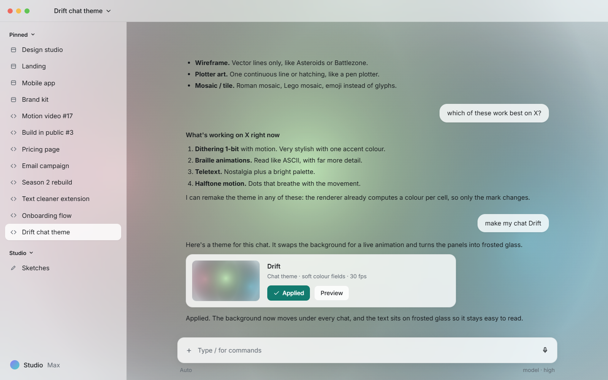
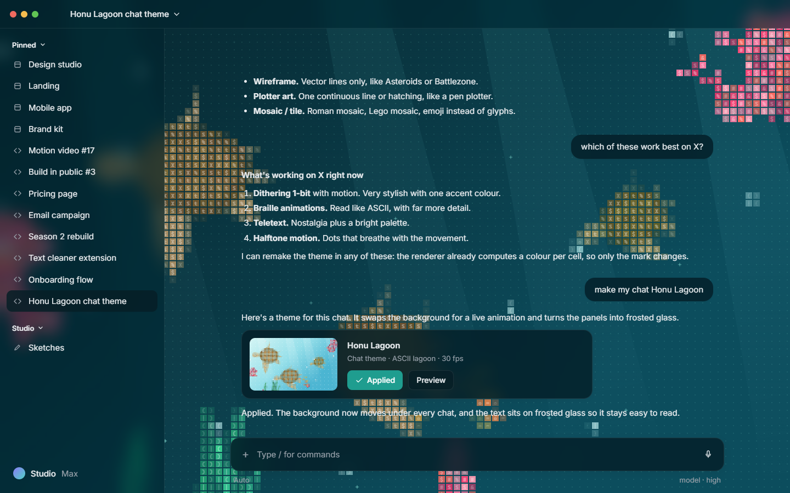

# diorama

[](https://github.com/arjunpundeer7/diorama/actions/workflows/ci.yml)
[](https://arjunpundeer7.github.io/diorama/gallery.html)
[](LICENSE)


Living backgrounds for the apps you write code and chat in. Cursor, VS Code, the Codex
app, claude.ai, chatgpt.com and your terminal get an animated scene behind the interface,
and their panels turn to frosted glass so text stays readable.



**[Try the themes in your browser](https://arjunpundeer7.github.io/diorama/gallery.html)**. Nothing to install.

## Themes

| | |
| --- | --- |
|  **Honu Lagoon** `lagoon`<br>Sea turtles, coral and fish as coloured ASCII tiles. |  **Night Orbit** `orbit`<br>A ringed planet, its moon and drifting stars in braille. |
|  **Dune Drift** `dunes`<br>Rolling dunes and a low sun in 1-bit dither with one accent. |  **Koi Pond** `koi`<br>Koi, lily pads and ripples in halftone dots. |
|  **Drift** `drift`<br>Three soft colour fields. The simplest scene to start from. |  Every theme has a light and a dark version and follows the app. |

Any theme can be drawn in any of six styles: `ascii`, `braille`, `halftone`, `dither`,
`mosaic` and `teletext`. Try `diorama preview lagoon --mark braille`.

## Install

You need [Node.js](https://nodejs.org) 22 or newer.

```sh
npx github:arjunpundeer7/diorama preview      # try it without installing
npm install -g github:arjunpundeer7/diorama   # install the diorama command
```

The browser extension and the editor extension are also on the
[Releases page](https://github.com/arjunpundeer7/diorama/releases) as ready-made downloads.

## Use it

**Pick a theme.** `diorama preview` opens a gallery. `diorama preview koi` shows one theme in a
demo chat app where you can switch themes, styles and light/dark.

**Editors** (Cursor, VS Code, Windsurf, VSCodium):

```sh
diorama apply lagoon cursor vscode
```

Reload the editor windows. Editor updates remove the theme, so either run the command again
after an update, or install the editor extension (`diorama-vscode-*.vsix` from Releases,
then **diorama: Apply Theme**), which puts it back on its own.

**The Codex desktop app:**

```sh
diorama launch codex --theme koi --restart
```

Codex restarts with the theme, which stays while the command runs.

**claude.ai and chatgpt.com:** download `diorama-extension-*.zip` from Releases, unzip it,
open `chrome://extensions`, turn on Developer mode and choose Load unpacked. The popup picks
the theme and style, turns it off per site and pauses the animation.

**Terminals** (Windows Terminal, Ghostty):

```sh
diorama apply orbit windows-terminal
```

`diorama restore <app>` undoes any of these. `diorama status` lists what is applied where.

## Make it yours

Tweak a theme without touching code:

```sh
diorama apply lagoon cursor --set turtles=6 --set speed=0.6
diorama apply koi vscode --mark braille --fps 20
```

Build your own theme from an existing one:

```sh
diorama new theme sunrise --from dunes     # copies it to ~/.diorama/themes/sunrise
diorama preview sunrise --stage            # edit scene.js, reload the page
diorama apply sunrise cursor
```

Theme another app or website:

```sh
diorama new skin notes --url "https://notes.example.com/*"
diorama new app my-editor --exe "C:\path\to\MyEditor.exe" --skin notes
diorama launch my-editor --report --inspect
```

`--inspect` lists whatever still hides the background, with a selector you can paste into
the skin. `diorama build extension` packs your own themes and skins into the browser extension.

| Guide | |
| --- | --- |
| [Writing a theme](docs/themes.md) | theme.json, the scene API, the cell engine and terminal shaders |
| [Writing a skin](docs/skins.md) | making an app see-through, and the inspector |
| [How it works](docs/architecture.md) | how each app is reached |
| [Security](docs/security.md) | the sandbox and exactly what gets changed |

## What's been checked

| App | How | Checked on |
| --- | --- | --- |
| VS Code | `apply`, `launch` | 1.143 on Windows: apply, reload, restart, restore, editor extension, uninstall |
| Cursor | `apply`, `launch` | 3.23 on Windows |
| Codex desktop app | `launch` | 26.1021 on Windows |
| claude.ai, chatgpt.com | extension | signed-out pages; the signed-in chat views need checking |
| Windows Terminal | `apply` | install and restore; shaders compile with the D3D compiler |
| Ghostty | `apply` | install and restore; shaders compile and render in WebGL |
| Windsurf, VSCodium, VS Code Insiders | `apply`, `launch` | not yet |
| Claude Desktop | none | it refuses DevTools connections on purpose; use claude.ai instead |

macOS and Linux paths are in place but haven't been tried on real installs yet. Reports
and fixes are very welcome.

## How it works

A small runtime goes into the app's page: through the browser extension, a patched
`workbench.html` in editors, or the DevTools protocol for `diorama launch`. It adds a layer
behind the app holding a sandboxed iframe, where the theme draws, and one stylesheet that
makes the app's surfaces clear or frosted. Theme code never runs in the app's page and
cannot reach it or the network.

## Contributing

New themes, skin fixes and reports from macOS and Linux are the most useful right now.
See [CONTRIBUTING.md](CONTRIBUTING.md).

```sh
git clone https://github.com/arjunpundeer7/diorama && cd diorama
npm install && npm test
node bin/diorama.js preview
```

## A note on the apps

diorama changes how other companies' apps look on your own machine. It doesn't
redistribute their code and it undoes what it changes, but modifying an app can still go
against its terms, so check before you use it. diorama is not affiliated with Anthropic,
OpenAI, Microsoft, Anysphere or anyone else whose app it themes.

## License

[MIT](LICENSE)
